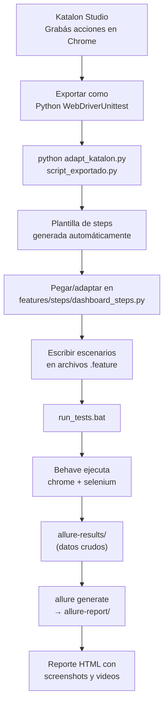

# S10-26-EQUIPO7

## RepuSense – Radar de Reputación en Crisis

Simulación No Country – Plataforma de prospección comercial que identifica negocios con oportunidades de mejora en su reputación online mediante datos de Google Maps e inteligencia artificial.

# QA_FRONT — Guía completa RepuSense

## Estructura creada

```
QA/QA_FRONT/
├── requirements.txt              ← dependencias Python
├── run_tests.bat                 ← doble clic para ejecutar todo
├── adapt_katalon.py              ← convierte scripts de Katalon a Behave
├── videos/                       ← grabaciones MP4 por escenario
├── allure-results/               ← datos crudos del reporte
├── allure-report/                ← reporte HTML generado
└── features/
    ├── environment.py            ← setup Chrome + grabación de video
    ├── dashboard_carga.feature   ← Gherkin: carga inicial
    ├── dashboard_filtros.feature ← Gherkin: filtros ciudad/rubro
    ├── dashboard_csv.feature     ← Gherkin: exportar CSV
    ├── dashboard_email.feature   ← Gherkin: columna email + copiar
    └── steps/
        └── dashboard_steps.py   ← implementación Selenium de cada step
```

---

## Qué hace cada archivo

| Archivo | Propósito |
|---|---|
| `environment.py` | Levanta Chrome automático (sin instalar driver), graba la pantalla, adjunta screenshot + video al reporte si un test falla |
| `*.feature` | Casos de prueba escritos en Gherkin (lenguaje natural). **Acá agregás nuevos escenarios** |
| `dashboard_steps.py` | Código Selenium que ejecuta cada paso del Gherkin |
| `run_tests.bat` | Script todo-en-uno: limpia resultados viejos → ejecuta → genera reporte → abre en navegador |
| `adapt_katalon.py` | Convierte scripts exportados de Katalon a plantillas de steps Behave |

---

## Requisitos previos antes de ejecutar

> [!IMPORTANT]
> Los **tres servidores** deben estar corriendo:

**Terminal 1 — Backend:**
```powershell
cd c:\Users\tereg\Desktop\Documentos\S10-26-EQUIPO7\backend
.\mvnw.cmd spring-boot:run
```

**Terminal 2 — Frontend:**
```powershell
cd c:\Users\tereg\Desktop\Documentos\S10-26-EQUIPO7\FRONT
npm run dev
```

**Terminal 3 — Pruebas:**
```powershell
cd c:\Users\tereg\Desktop\Documentos\S10-26-EQUIPO7\QA\QA_FRONT
.\run_tests.bat
```

> [!NOTE]
> ChromeDriver se descarga automáticamente la primera vez gracias a `webdriver-manager`. No necesitás instalarlo manualmente.

---

## Cómo funciona el flujo completo



---

## Cómo usar Katalon + adaptar scripts

### Paso 1 — Grabar en Katalon
1. Abrí Katalon Studio → **New Test Case** → botón **Record Web**
2. Ingresá la URL: `http://localhost:5173`
3. Realizá las acciones que querés probar
4. Click **Stop** → guardá el Test Case

### Paso 2 — Exportar a Python
1. Click derecho en el Test Case → **Export to other test framework**
2. Seleccioná **Python - WebDriverUnittest**
3. Guardá el archivo `.py` en alguna carpeta temporal

### Paso 3 — Adaptar con el script
```powershell
cd QA\QA_FRONT
python adapt_katalon.py C:\ruta\al\script_katalon.py
```
Esto genera un archivo `script_katalon_behave_steps.py` con una plantilla lista.

### Paso 4 — Integrar en Behave
1. Copiá los `@when`/`@then` del archivo generado a `features/steps/dashboard_steps.py`
2. Reemplazá `self.driver` → `context.driver`
3. Escribí el escenario `.feature` correspondiente

---

## Escenarios disponibles (9 en total)

### `dashboard_carga.feature` (2 escenarios)
- ✅ La tabla muestra comercios al cargar
- ✅ Las columnas esperadas están presentes (Comercio, Ciudad, Rating, Email)

### `dashboard_filtros.feature` (3 escenarios)
- ✅ Filtrar por ciudad Córdoba
- ✅ Filtrar por rubro Restaurante
- ✅ Limpiar filtro restaura todos los registros

### `dashboard_csv.feature` (2 escenarios)
- ✅ Exportar todos los comercios a CSV
- ✅ Exportar comercios seleccionados a CSV

### `dashboard_email.feature` (2 escenarios)
- ✅ Columna Email muestra datos en cada fila
- ✅ Botón copiar email muestra alerta de confirmación

---

## Cómo agregar un nuevo escenario

> [!TIP]
> No necesitás tocar el código Python para agregar escenarios básicos — solo editás el `.feature`.

**Ejemplo: agregar prueba de login**

1. Crear `features/login.feature`:
```gherkin
Feature: Login de RepuSense
  Scenario: Login exitoso con credenciales válidas
    Given que el usuario abre el dashboard
    When ingresa email "admin@repusense.com" y contraseña "Password123!"
    And hace clic en el botón "Iniciar sesión"
    Then la tabla debe mostrar al menos un comercio
```

2. Agregar los steps en `dashboard_steps.py`:
```python
@when('ingresa email "{email}" y contraseña "{password}"')
def step_login(context, email, password):
    context.driver.find_element(By.CSS_SELECTOR, "input[type='email']").send_keys(email)
    context.driver.find_element(By.CSS_SELECTOR, "input[type='password']").send_keys(password)
```

---


## Ejecutar solo algunos escenarios

```powershell
# Solo los tests de CSV:
behave features/dashboard_csv.feature

# Solo un escenario específico por nombre:
behave --name "Exportar todos los comercios"

# Con etiqueta (si agregás @smoke en el .feature):
behave --tags=@smoke
```

---


> [!WARNING]
>allure serve allure-results
